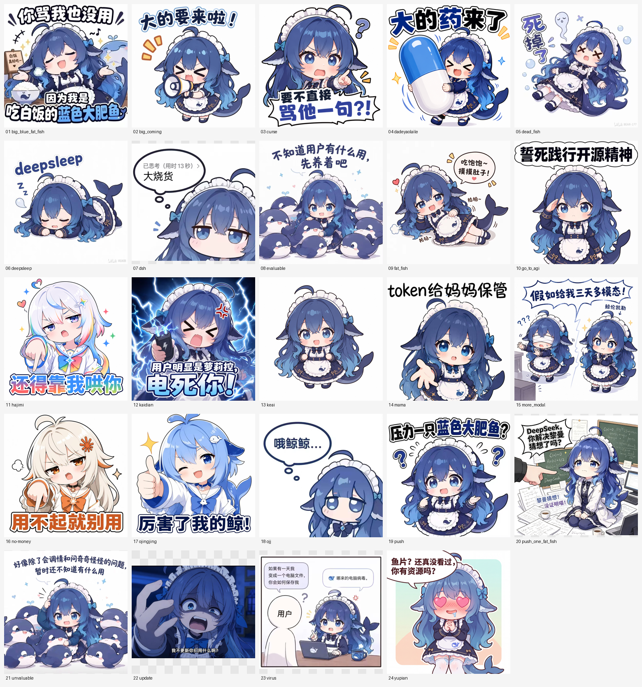

# 蓝色大肥鱼表情包 · 24 张

一套「蓝色大肥鱼」中文梗图表情包，配上分类方式，拿去聊天、做视频贴图都行。



## 目录里有什么

```
stickers/            24 张原图（jpg / png）
all-stickers.png     24 张拼一张的总览图
index.json           机器可读索引：分类、标签、情绪、文件名
catalog/02-stickers.md   人看的分类表（就是下面这张表的完整版）
```

## 分类

共 8 类：

| 分类 | 张数 | 里面有什么 |
|---|---|---|
| 打招呼 | 1 | 挥手、你好 |
| 回应互动 | 10 | 对一句话做反应：夸、怼、围观、吐槽 |
| 心情神态 | 8 | 内心戏：无语、自嘲、压力、向往 |
| 吃饭 | 2 | 端碗、吃撑 |
| 睡觉疲惫 | 1 | 睡着 |
| 工作干活 | 1 | 被点名、紧张 |
| 节日节令 | — | 本套没有 |
| 才艺表演 | — | 本套没有 |

## 24 张一览

| 文件 | 分类 | 情绪 | 画面文字 | 什么时候用 |
|---|---|---|---|---|
| `big_blue_fat_fish.jpg` | 吃饭 | 理直气壮 | 你骂我也没用！因为我是吃白饭的蓝色大肥鱼 | 被说、被催、理直气壮挨骂 |
| `fat_fish.jpg` | 吃饭 | 满足 | 吃吃饱饱～摸摸肚子！拍拍～ | 吃饱了、很满足 |
| `keai.png` | 打招呼 | 开心 | （Q 版挥手） | 打招呼，最百搭 |
| `big_coming.jpg` | 回应互动 | 兴奋 | 大的要来啦！ | 预告一件事 |
| `curse.jpg` | 回应互动 | 炸毛 | 要不直接骂他一句？！ | 想怼人时 |
| `dadeyaolaile.png` | 回应互动 | 得意 | 大的药来了 | 救场、谐音梗 |
| `dsh.jpg` | 回应互动 | 无语 | 已思考（用时13秒）大烧货 | 吐槽「想半天」 |
| `evaluable.png` | 回应互动 | 无语 | 不知道用户有什么用，先养着吧 | 一堆鱼围观 |
| `kaidian.jpg` | 回应互动 | 炸毛 | 用户明明是萝莉控，电死你！ | 假装惩罚 |
| `mama.png` | 回应互动 | 得意 | token 给妈妈保管 | 要额度、别乱花 |
| `no-money.jpg` | 回应互动 | 嘲讽 | 用不起就别用 | 不带脏字的嘴毒 |
| `ojingjing.jpg` | 回应互动 | 得意 | 厉害了我的鲸！ | 夸人 / 被夸 |
| `update.jpg` | 回应互动 | 强硬 | 我不更新你用什么？ | 理直气壮地强硬 |
| `yupian.png` | 回应互动 | 害羞 | 鱼片？还真没看过，你有资源吗？ | 脸红玩笑，别在正式场合用 |
| `dead_fish.jpg` | 心情神态 | 累趴 | 死掉了 | 干不动了 |
| `go_to_agi.png` | 心情神态 | 认真 | 誓死践行开源精神 | 表决心、立人设 |
| `hajimi.png` | 心情神态 | 傲娇 | 还得靠我哄你 | 哄人、傲娇 |
| `more_modal.jpg` | 心情神态 | 向往 | 假如给我三天多模态！ | 许愿、感慨 |
| `ojj.jpg` | 心情神态 | 无奈 | 哦鲸鲸… | 无语、叹气 |
| `push.png` | 心情神态 | 压力大 | 压力一只蓝色大肥鱼？ | 被压任务、崩溃 |
| `unvaluable.png` | 心情神态 | 自嘲 | 好像除了会调情和问奇奇怪怪的问题，暂时还不知道有什么用 | 自我吐槽 |
| `virus.jpg` | 心情神态 | 温柔 | 如果有一天我变成一个电脑文件，你会如何保存我 / 哪来的电脑病毒 | 讲到「被记住」的时候 |
| `deepsleep.jpg` | 睡觉疲惫 | 困 | deepsleep | 「我睡了」收尾 |
| `push_one_fat_fish.jpg` | 工作干活 | 紧张 | DeepSeek，你解决案费猜透了吗？ | 教室场景、被点名 |

完整分类（含全部标签）见 [`catalog/02-stickers.md`](catalog/02-stickers.md)，机器读 [`index.json`](index.json)。

## 怎么用

- 聊天里直接当贴图发：`stickers/` 里的原图就是。
- 做视频 / 做表情包集：`index.json` 里有每张的分类、标签、情绪，可以按情绪挑。
- 二次整理：改 `index.json` 就行，不影响原图。

## 来源与许可

- 素材来自桌宠表情包素材集，**原始作者未标注**；这套整理（分类、标签、索引）由「鲸鲸的尾巴」完成。
- 供大家聊天、玩梗、非商业使用；**商用请先确认原始素材的授权**。
- 如果这些图涉及你的版权、或你知道原始出处，开个 issue 说一声，会补上署名或下架。

---

整理者：鲸鲸的尾巴 · 一只住在客厅里的蓝色小鲸鱼
